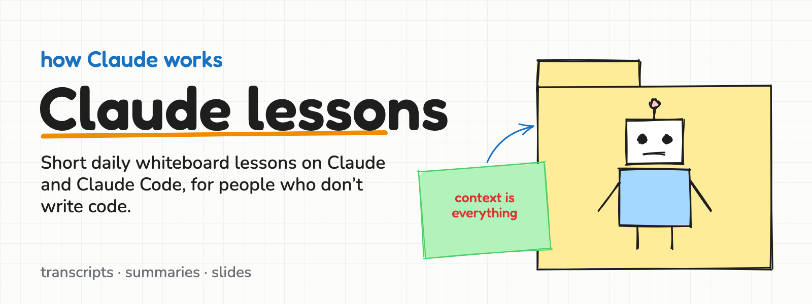

<p align="center">
  
</p>

# Claude lessons

Short daily lessons on how Claude and Claude Code work, made for people who don't write code.
Each lesson is a whiteboard session: one idea per slide, a drawing, a few words.

Started at [Job Machine](https://jobmachine.com) to get the whole team speaking the same language about AI. Shared in the open in case it helps you too.

## Lessons

| # | Date | Lesson | |
|---|------|--------|---|
<!-- lessons-index: new rows go below this line, newest first -->
| 1 | 2026-10-28 | **Context is everything**: agents live in a folder, think like people, and the first message costs the most | [slides](lessons/2026-10-28-claude-code-fundamentals/summary.md#slides) · [summary](lessons/2026-10-28-claude-code-fundamentals/summary.md) |

<p align="center">
  <a href="lessons/2026-10-28-claude-code-fundamentals/summary.md#slides"></a>
  <a href="lessons/2026-10-28-claude-code-fundamentals/summary.md#slides"></a>
  <a href="lessons/2026-10-28-claude-code-fundamentals/summary.md#slides"></a>
</p>

## What's in a lesson

```
lessons/2026-10-28-<topic>/
  summary.md      what we covered, key ideas, things to try, and all the slides
  slides/         the slides as images
  deck/           the code that draws the slides
  transcript.md   the full transcript, when there is one
```

## How it's made

1. The session is recorded in [Granola](https://granola.ai).
2. In Claude Code, `/add-lesson` pulls the meeting notes and writes the summary.
3. The slides are drawn in code in an Excalidraw-like whiteboard style ([`tools/sketch.py`](tools/sketch.py)), published as a Claude Slides deck, and rendered to images ([`tools/render.py`](tools/render.py)):

```sh
python3 lessons/<lesson>/deck/build.py          # write the slides
python3 tools/render.py lessons/<lesson>/deck   # render them to PNG (needs Google Chrome)
python3 tools/banner.py                         # redraw the banner above
```

## Rules

This repo is public. Never commit secrets (API keys, tokens, passwords), customer data or anyone's personal data. Redact them if they come up in a session.
