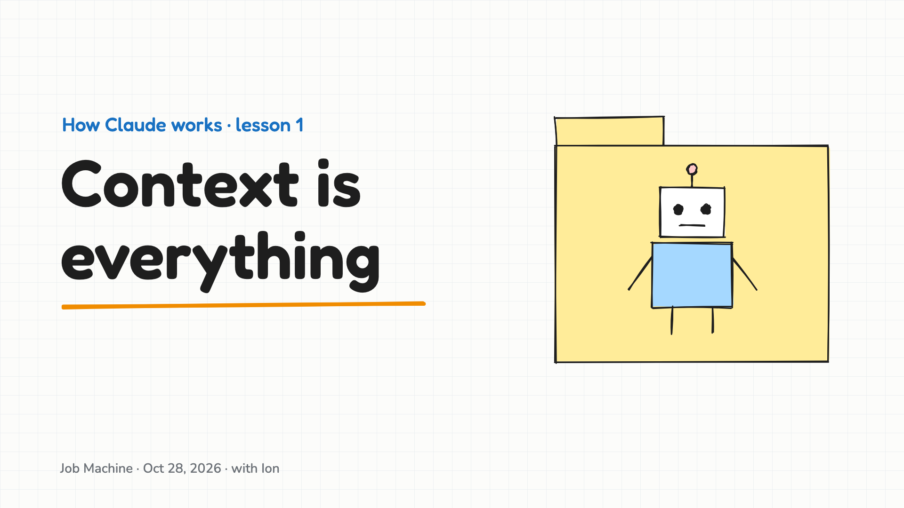
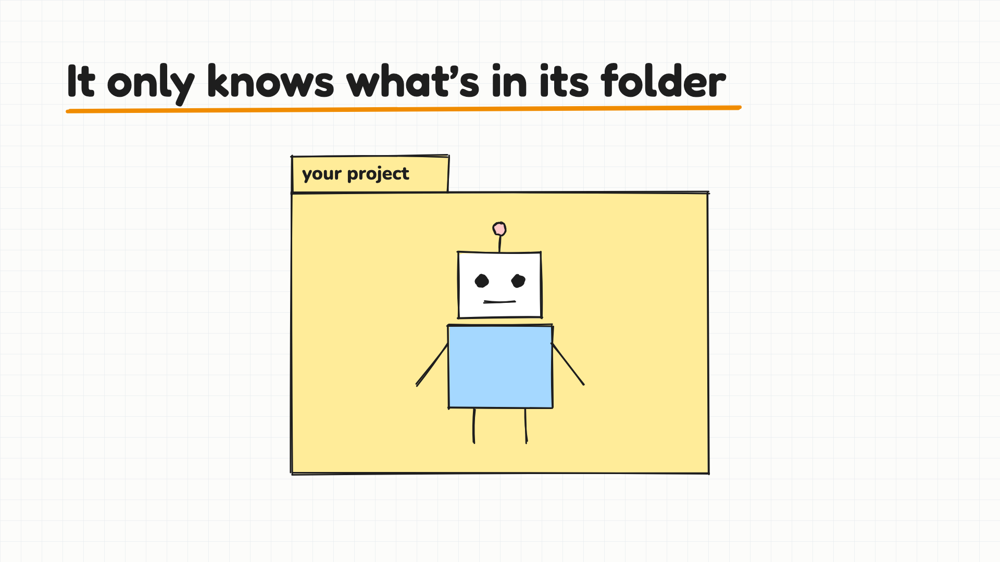
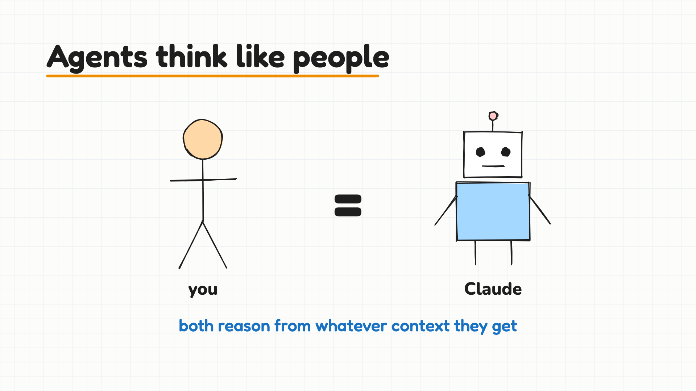
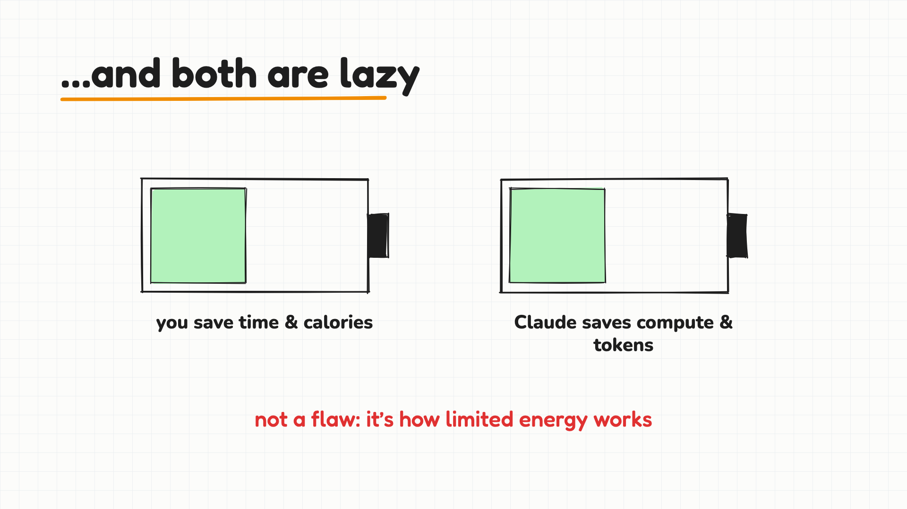
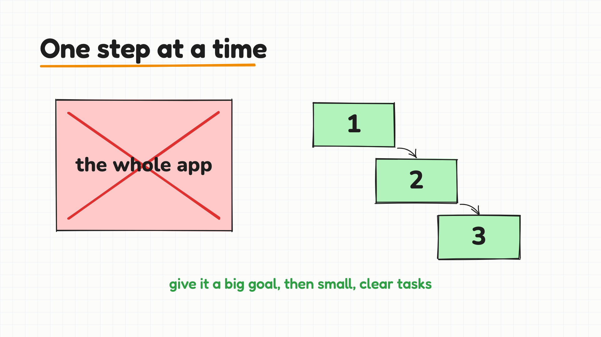
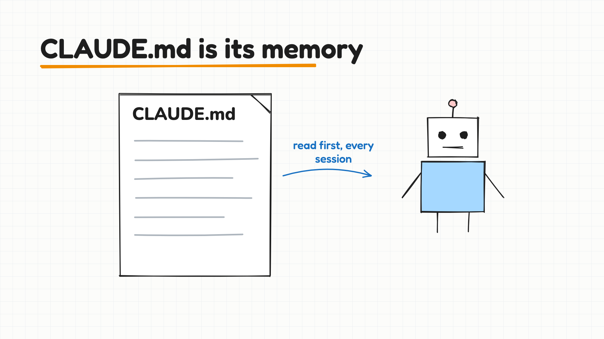
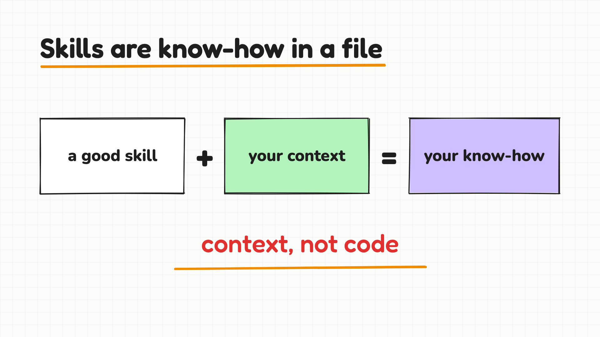
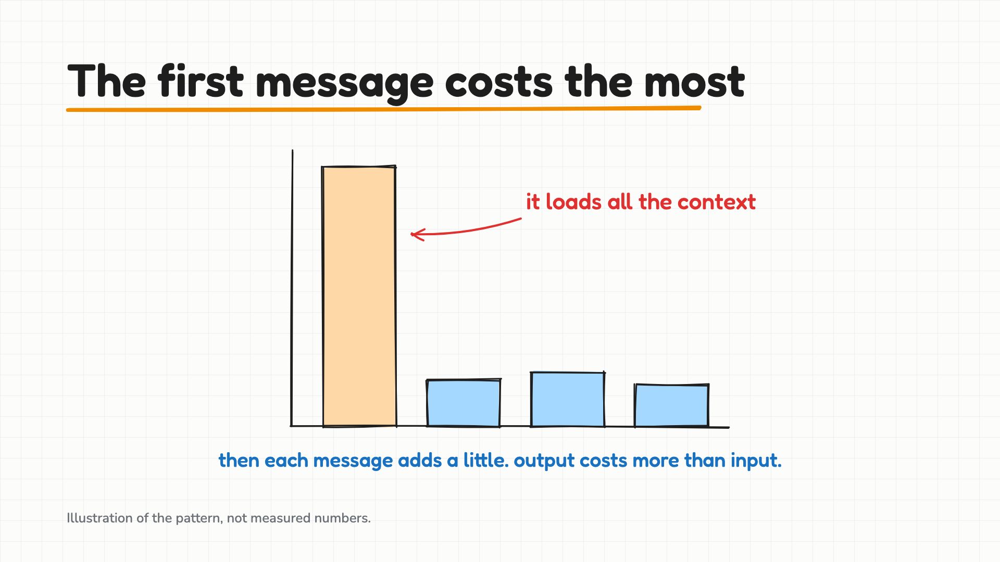
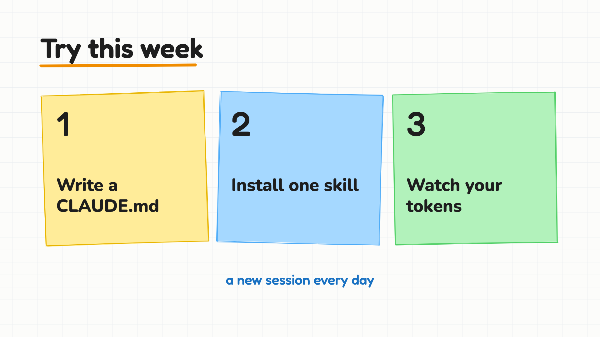

# Claude Code fundamentals and managing an agent's context

**Date:** 2026-10-28 · **Host:** Ion

**In one line:** An agent works from what it can see in its folder, so give it good context, a clear goal and small tasks.

## What we covered

- An agent "lives" inside a folder. Look after that folder: missing or leaked context leads to mistakes and worse output.
- Agents and people have two things in common:
  - They reason from the information they're given.
  - They're lazy by default, because resources are limited (time and calories for people, compute and energy for agents). This comes from those limits. It isn't a flaw.
- Asking an agent to build a big project in one go fights against how Anthropic tuned the models. Give it ambition and a clear purpose instead, and split the work into small, scoped tasks.
- `CLAUDE.md` in a project folder is the agent's working memory for that project.
  - Put a `context/` subfolder next to it to organize knowledge by area (for example, migration).
  - Don't over-engineer this. Start with Anthropic's defaults before adding third-party memory tools like SuperMemory.
- **Skills** (see skills.sh) are markdown files that give the agent deep expertise in one area: Supabase, Vercel, UI, QA, browser automation.
  - Start from the best existing skill, then add your own context and edge cases.
  - Your customized version is your own know-how. You don't need to publish it.
  - Skills are context, not code.
- **Tokens cost money, and you can see the cost.** The first message in a session is the most expensive because it loads all the context. Later messages add a bit at a time.
  - You pay for input and output, and output always costs more.
  - Use Opus 5.5 as the default model in Claude Code.
- **Basics:** tokens are the unit of information for AI. Underneath is binary: bits (0/1) → bytes → kilobytes → megabytes → gigabytes → terabytes.
- **The big picture:** Ion's view is that Claude Code ends traditional software engineering, as the last software tool anyone will build, and that Anthropic's valuation reflects this bet.

## Key ideas

1. Context is everything. Keep the agent's folder and `CLAUDE.md` clean and current.
2. Don't one-shot big projects. Give a clear goal and break the work into scoped tasks.
3. Skills are reusable context. Start from a good one and make it yours.
4. Every message costs tokens, and the first one in a session costs the most.

## Try this

- Add a `CLAUDE.md` to a project folder you work in, with a few lines on what the project is and its rules.
- Install a skill for a tool you use (for example, Supabase) and see how the answers change.
- Watch the token count across one session: compare the first message with the later ones.

## Next

Daily sessions until everyone speaks the same language.

## Slides

